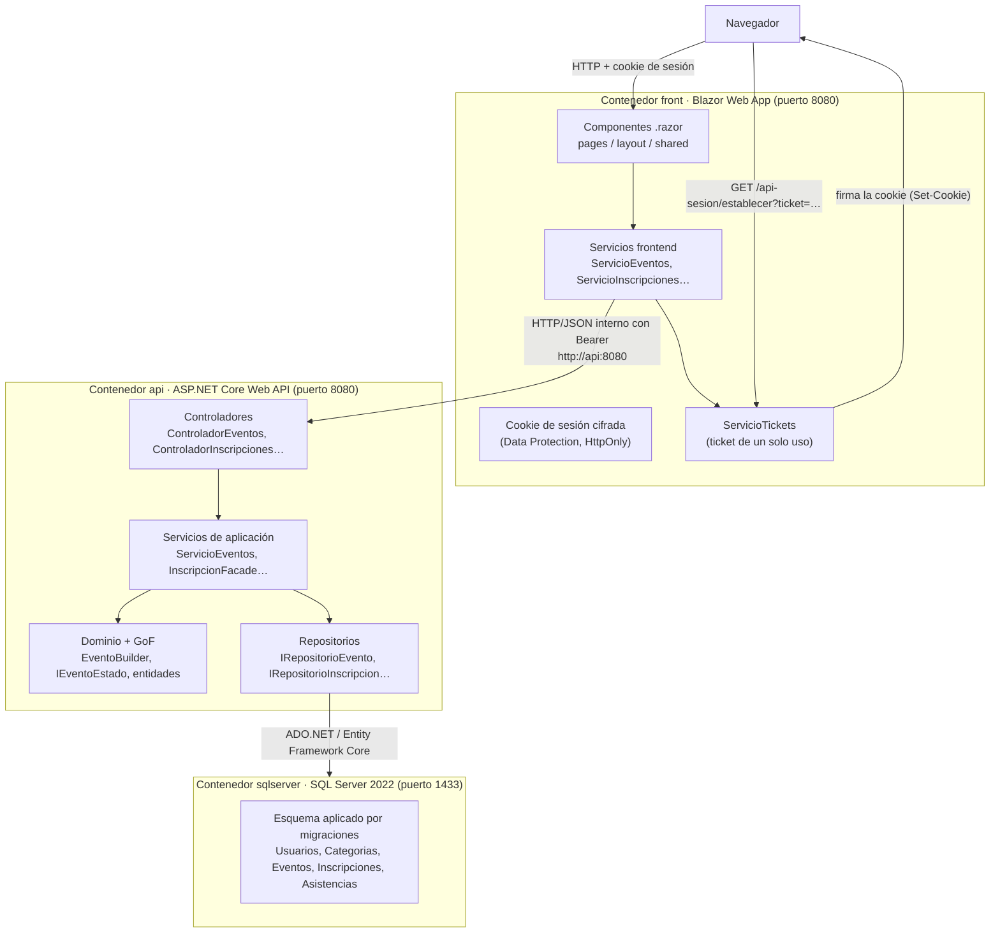

# Informe de Arquitectura, SOLID y Patrones GoF

**Sistema de Gestión de Eventos Académicos** — Prototipo funcional académico
Equipo: Juan Pablo Gutiérrez Vargas, Sergio Andrés Claro Rivero y Tomás Álvarez Castillo
Asignatura: Diseño de Sistemas de Información · Docente: Aníbal Antonio Torres Cañas

---

## 1. Objetivo y alcance

Este proyecto es un **prototipo académico demostrativo** del Sistema de Gestión de Eventos
Académicos. No es un producto empresarial: su objetivo es materializar, de forma
ejecutable, el modelo de dominio, los requisitos funcionales (RF-01 a RF-12), las reglas de
negocio (RN-01 a RN-08), los principios SOLID y los tres patrones GoF aprobados en
`docs/PATRONES.md` (Builder, Facade y State).

### 1.1 Flujo principal del MVP

El recorrido central, y el que debe ser más fácil de encontrar y demostrar, es:

1. El **responsable** inicia sesión y registra un evento futuro con cupos válidos.
2. El **estudiante** inicia sesión y consulta el listado real de eventos.
3. El estudiante abre el **detalle** del evento recién registrado.
4. El estudiante se **inscribe** y recibe la confirmación.

### 1.2 Funcionalidades complementarias implementadas

También están implementadas y son navegables desde el menú según el rol, sin desplazar el
flujo principal: filtrado de eventos, consulta y cancelación de inscripciones,
consulta de eventos gestionados, modificación de eventos, consulta de participantes y
registro y consulta de asistencia.

### 1.3 Fuera de alcance (declarado explícitamente)

El prototipo **no** incluye autenticación institucional, OAuth ni proveedores externos;
tampoco correo, SMS, notificaciones, pagos, calendarios externos, analítica, telemetría
externa, servicios cloud, Kubernetes, microservicios, colas ni brokers. Los datos visibles
provienen siempre de SQL Server a través de la API: no hay datos estáticos en la interfaz.

---

## 2. Arquitectura implementada

### 2.1 Capas y responsabilidades reales

| Capa | Tecnología | Responsabilidad |
| --- | --- | --- |
| Presentación | Blazor Web App (`front/`), interactividad de servidor | Pantallas, formularios, navegación y estados visuales. No accede a SQL Server. |
| API | ASP.NET Core Web API (`api-gestion-academico/controllers/`) | Endpoints HTTP, códigos de respuesta y validación de la entrada. |
| Aplicación | Servicios (`api-gestion-academico/servicios/`) | Casos de uso, coordinación, reglas de aplicación y autorización por rol. |
| Dominio | Modelos (`api-gestion-academico/modelos/`) | Entidades, invariantes y comportamiento (Builder y State). |
| Persistencia | Repositorios + Entity Framework Core (`api-gestion-academico/repositorios/`) | Acceso a datos, transacciones y bloqueo de concurrencia. |
| Datos | SQL Server 2022 (contenedor `sqlserver`) | Persistencia real y duradera en el volumen `datos-sql`. |
| Orquestación | Docker Compose (`docker-compose.yml`) | Red interna, variables de entorno, healthchecks y orden de arranque. |

### 2.2 Autenticación y sesión del frontend

La sesión se apoya en la **autenticación por cookie de ASP.NET Core** (`AddAuthentication`
+ `AddCookie` en `front/Program.cs`), con estas piezas:

| Pieza | Archivo | Función |
| --- | --- | --- |
| Validación de credenciales | `front/services/ServicioAutenticacion.cs` | Llama a `POST /api/auth/login` (servidor a servidor) y, si son correctas, registra un **ticket de un solo uso**. |
| Almacén de tickets | `front/services/ServicioTickets.cs` | Singleton con tickets aleatorios de 2 minutos de vigencia. El token JWT **nunca** llega al navegador. |
| Canje por cookie | `front/Program.cs` (`GET /api-sesion/establecer`) | Consume el ticket, firma la cookie cifrada con Data Protection (`HttpOnly`, `SameSite=Lax`) y redirige a la pantalla del rol. |
| Token hacia la API | `front/services/ClienteApiBase.cs` | Extrae la claim `token-api` de la cookie (vía `AuthenticationStateProvider`) y adjunta el encabezado `Authorization` en cada petición. |
| Cierre de sesión | `front/Program.cs` (`GET /api-sesion/cerrar`) | Elimina la cookie y redirige al acceso. |

Consecuencias de diseño:

- **El estado de autenticación sobrevive a las recargas** del navegador: la cookie viaja en
  cada petición y el circuito la valida. Las claves de Data Protection se conservan en el
  volumen `claves-front`, de modo que la cookie sigue siendo válida aunque se recree el
  contenedor.
- **El token se adjunta de forma explícita por petición**, no con un `DelegatingHandler`.
  Los handlers creados por `IHttpClientFactory` se resuelven desde el proveedor raíz, donde
  los servicios con ámbito de circuito son **instancias distintas**; con el handler, el
  token nunca se habría adjuntado y todas las peticiones protegidas habrían respondido 401.
- **`AddAuthentication()` es indispensable**: sin él, el middleware de autorización de las
  páginas protegidas falla al emitir el *challenge* (`IAuthenticationService` no registrado)
  y la respuesta es HTTP 500.
- La API conserva su propia autenticación por JWT: el frontend es un cliente más y nunca
  elude los controles de autorización del servidor.

### 2.3 Diagrama de dependencias



### 2.4 Nota sobre el diseño anterior de la sesión

La primera versión conservaba la sesión en un servicio con ámbito de circuito
(`ServicioSesion`) y añadía el token a las peticiones con un `DelegatingHandler`
(`ManejadorToken`). Ese diseño **no funcionaba**: el token nunca se adjuntaba y las rutas
protegidas devolvían HTTP 500. Se sustituyó por el descrito en 2.2, y el motivo se
detalla en la sección 9.3 porque es un ejemplo real de por qué el ámbito de los servicios
y de los handlers de `IHttpClientFactory` debe verificarse, no asumirse.

## 3. Relación con el modelo de dominio y el MER

### 3.1 Nota de trazabilidad

El repositorio contiene `docs/Modelo_Verbal_del_Sistema.md` con el modelo de clases del
proyecto (entidades, atributos y enumeraciones) y `docs/Arquitectura_C4_...md` con la
arquitectura C4. **No se encontró un MER (modelo entidad-relación) formal en el repositorio**,
por lo que la representación relacional se construyó a partir de ese modelo de clases y de
las relaciones descritas en el Modelo Verbal. El script resultante es
`db/ModeloRelacional.sql` y la aplicación efectiva la realizan las migraciones de Entity
Framework Core (`api-gestion-academico/repositorios/Migraciones/`), que son el origen de
ambos: el script es la expresión SQL exacta de las migraciones.

### 3.2 Correspondencia entidad ↔ tabla

| Entidad del modelo de clases | Tabla | Clave primaria | Claves foráneas | Atributos persistidos |
| --- | --- | --- | --- | --- |
| `Usuario` (abstracta) | `Usuarios` (TPH) | `Id` | — | `NombreCompleto`, `Email`, `ContrasenaHash`, `Rol`, `Activo` |
| `Estudiante` | `Usuarios` (discriminador `Rol = 'Estudiante'`) | `Id` (heredada) | — | `Codigo`, `Programa` |
| `Responsable` | `Usuarios` (discriminador `Rol = 'Responsable'`) | `Id` (heredada) | — | `Dependencia`, `Cargo` |
| `Categoria` | `Categorias` | `Id` | — | `Nombre` (único), `Descripcion` |
| `Evento` | `Eventos` | `Id` | `ResponsableId` → `Usuarios.Id`, `CategoriaId` → `Categorias.Id` | `Nombre`, `Descripcion`, `FechaHoraInicio`, `FechaHoraFin`, `Lugar`, `CuposTotales`, `Estado`, `FechaRegistro`, `Version` |
| `Inscripcion` | `Inscripciones` | `Id` | `EstudianteId` → `Usuarios.Id`, `EventoId` → `Eventos.Id` | `FechaHoraRegistro`, `Estado`, `FechaHoraCancelacion` |
| `Asistencia` | `Asistencias` | `Id` | `InscripcionId` → `Inscripciones.Id` (única) | `Asistio`, `FechaHoraRegistro`, `Observacion` |

### 3.3 Relaciones del modelo de clases

- Un `Responsable` **gestiona** varios `Evento` → `Eventos.ResponsableId` (1 a 0..*).
- Una `Categoria` **clasifica** varios `Evento` → `Eventos.CategoriaId` (1 a 0..*).
- Un `Estudiante` **realiza** varias `Inscripcion` → `Inscripciones.EstudianteId` (1 a 0..*).
- Un `Evento` **recibe** varias `Inscripcion` → `Inscripciones.EventoId` (1 a 0..*).
- Una `Inscripcion` **tiene** como máximo un registro de `Asistencia` → `Asistencias.InscripcionId` (1 a 0..1).

### 3.4 Decisiones sobre la persistencia

- **Cupos disponibles no se almacenan.** Se calculan en el dominio como
  `CuposTotales − (inscripciones activas)` (`Evento.GetCuposDisponibles()`). Así no pueden
  existir valores contradictorios y el dato depende siempre de la fuente real.
- **La contraseña nunca se guarda en texto plano.** `ServicioHashContrasena` aplica
  PBKDF2-HMAC-SHA256 con 120 000 iteraciones y un salt aleatorio por usuario; el formato
  almacenado es `v1.{iteraciones}.{salt}.{hash}`.
- **`EstadoEvento` se conserva como enumeración persistida** (columna `Eventos.Estado`) y,
  al recuperar el evento, `FabricaEstadosEvento` reconstruye el objeto de estado con su
  comportamiento (patrón State). La base de datos guarda "qué estado es"; el dominio sabe
  "qué se puede hacer" en cada estado.
- **Control de concurrencia.** `UnidadTransaccionalSqlServer` abre una transacción con
  aislamiento `Serializable` y toma un bloqueo de aplicación exclusivo
  (`sp_getapplock`) sobre el recurso `evento:{id}` durante la inscripción, de modo que dos
  peticiones simultáneas no puedan ocupar el último cupo (RN-08). Además, `Eventos.Version`
  (`rowversion`) protege las modificaciones concurrentes del evento.
- **Integridad de duplicados en base de datos.** El índice único filtrado
  `UX_Inscripciones_Activas` impide dos inscripciones activas del mismo estudiante en el
  mismo evento aunque la validación de la aplicación fuera evitada (RN-02).

---

## 4. Aplicación de SOLID

> Cada apartado indica la definición, dónde se aplica, los archivos implicados, un ejemplo
> real del código, el problema de diseño que evita y las limitaciones que el MVP conserva.

### 4.1 SRP — Responsabilidad única

**Definición.** Una clase debe tener una sola razón para cambiar.

**Dónde se aplica.** En las cuatro capas del proyecto: controladores, servicios de
aplicación, entidades de dominio y repositorios.

**Archivos.**

- `api-gestion-academico/controllers/ControladorEventos.cs`
- `api-gestion-academico/controllers/ControladorInscripciones.cs`
- `api-gestion-academico/servicios/ServicioEventos.cs`
- `api-gestion-academico/servicios/InscripcionFacade.cs`
- `api-gestion-academico/servicios/ServicioParticipacion.cs`
- `api-gestion-academico/repositorios/RepositorioEvento.cs`
- `api-gestion-academico/modelos/Evento.cs`

**Ejemplo real.** El controlador de eventos solo traduce HTTP a casos de uso:

```csharp
// api-gestion-academico/controllers/ControladorEventos.cs
[HttpPost]
[Authorize(Roles = "Responsable")]
public async Task<ActionResult<EventoDetalleDto>> Registrar(
    [FromBody] PeticionEventoDto peticion, CancellationToken cancellationToken)
{
    var evento = await _eventos.CrearAsync(peticion, UsuarioIdActual, cancellationToken);
    return CreatedAtAction(nameof(Detalle), new { id = evento.Id }, evento);
}
```

La regla de negocio (RN-03 y RN-04) no está en el controlador: está en `EventoBuilder.Build()`.
La persistencia no está en el servicio: está en `RepositorioEvento`. La interfaz de usuario
no tiene reglas: solo presenta y captura.

**Problema que evita.** La versión del modelo de clases inicial (documentada en `docs/SOLID.md`)
tenía `Responsable.registrarEvento()`, `Responsable.registrarAsistencia()` y
`Usuario.autenticar()` mezclando datos de perfil con orquestación de casos de uso. Con esta
estructura, un cambio en la forma de registrar asistencia no obliga a tocar la jerarquía de
usuarios, y un cambio en el formato del JSON no obliga a tocar el dominio.

**Limitaciones conservadas.** `ServicioEventos` agrupa los cinco casos de uso de eventos
(listar, detalle, categorías, crear, modificar) porque todos comparten el mismo conjunto de
datos; se prefirió no fragmentarlo en servicios adicionales sin valor real para el MVP. La
entidad `Evento` mantiene la collections de inscripciones para poder calcular los cupos sin
una consulta adicional en cada lectura.

### 4.2 OCP — Abierto/cerrado

**Definición.** Las entidades de software deben estar abiertas a extensión y cerradas a
modificación.

**Dónde se aplica.** En el ciclo de vida del evento, mediante el patrón State
(`IEventoEstado` y sus seis implementaciones).

**Archivos.**

- `api-gestion-academico/modelos/estados/IEventoEstado.cs`
- `api-gestion-academico/modelos/estados/EstadoProgramado.cs`
- `api-gestion-academico/modelos/estados/EstadoInscripcionesAbiertas.cs`
- `api-gestion-academico/modelos/estados/EstadoInscripcionesCerradas.cs`
- `api-gestion-academico/modelos/estados/EstadoEnCurso.cs`
- `api-gestion-academico/modelos/estados/EstadoFinalizado.cs`
- `api-gestion-academico/modelos/estados/EstadoCancelado.cs`
- `api-gestion-academico/modelos/estados/FabricaEstadosEvento.cs`

**Ejemplo real.** `Evento` no contiene cadenas de `if` sobre el estado; delega:

```csharp
// api-gestion-academico/modelos/Evento.cs
public void RegistrarInscripcion(Estudiante estudiante) => EstadoActual.Inscribir(this, estudiante);

public void ActualizarEstado(DateTime ahora, int cuposDisponibles)
{
    for (var i = 0; i < 8; i++)
    {
        var transicion = EstadoActual.TransicionAutomatica(this, ahora, cuposDisponibles);
        if (transicion is null) return;
        Transicionar(transicion.Value);
    }
}
```

Cada estado decide por sí mismo si exige una transición (por tiempo o por cupos) y a qué
estado puede pasar. La tabla de transiciones está repartida en las clases de estado, y una
transición no permitida se rechaza con `ExcepcionNegocio`.

**Problema que evita.** Con un `switch` sobre el enumerador `EstadoEvento`, cada nuevo
estado obligaba a revisar todos los métodos afectados de `Evento` y de los servicios, y era
fácil olvidar un caso (por ejemplo, permitir la inscripción en un evento cancelado). Con el
patrón State, agregar un estado nuevo es crear una clase e implementarla en la fábrica.

**Limitaciones conservadas.** La fábrica `FabricaEstadosEvento` contiene un `switch` que
debe actualizarse al agregar un estado: es el punto de extensión único y explícito, y se
documentó para que no se pase por alto. No se creó una jerarquía adicional de estados ni
un «Director», porque el MVP no lo necesita.

### 4.3 LSP — Sustitución de Liskov

**Definición.** Un objeto de una subclase debe poder sustituir al de su clase base sin
alterar el comportamiento esperado del sistema.

**Dónde se aplica.** En la jerarquía `Usuario` / `Estudiante` / `Responsable` y en el
contrato común de los estados.

**Archivos.**

- `api-gestion-academico/modelos/Usuario.cs`
- `api-gestion-academico/modelos/Estudiante.cs`
- `api-gestion-academico/modelos/Responsable.cs`
- `api-gestion-academico/repositorios/ContextoDatos.cs` (discriminador y restricción)
- `api-gestion-academico/modelos/estados/IEventoEstado.cs`

**Ejemplo real.** El rol no es un campo libre: es el discriminador de la jerarquía en la
base de datos y coincide con el tipo concreto.

```csharp
// api-gestion-academico/repositorios/ContextoDatos.cs
usuario.HasDiscriminator<RolUsuario>("Rol")
    .HasValue<Estudiante>(RolUsuario.Estudiante)
    .HasValue<Responsable>(RolUsuario.Responsable);
```

y la base de datos lo valida:

```sql
CONSTRAINT [CK_Usuarios_Perfil] CHECK (
  ([Rol] = 'Estudiante' AND [Codigo] IS NOT NULL AND [Programa] IS NOT NULL AND [Dependencia] IS NULL AND [Cargo] IS NULL)
  OR
  ([Rol] = 'Responsable' AND [Codigo] IS NULL AND [Programa] IS NULL AND [Dependencia] IS NOT NULL AND [Cargo] IS NOT NULL))
```

Además, cada estado implementa el contrato completo de `IEventoEstado` (los seis métodos),
de modo que un estado puede sustituir a otro sin romper a `Evento`.

**Problema que evita.** La documentación original advertía el riesgo de que el atributo
`Rol` y el tipo concreto se contradijeran y fallaran las comprobaciones de autorización. Con
el discriminador único, la contradicción es imposible: la columna `Rol` **es** el tipo.

**Limitaciones conservadas.** `Usuario` mantiene `GetRol()` por compatibilidad con el
diagrama de clases, aunque la mayoría de los puntos del código leen el rol del claim del
token. `Estudiante` y `Responsable` no son `sealed` para permitir la herencia implícita del
constructor protegido, decisión menor que no afecta al comportamiento.

### 4.4 ISP — Segregación de interfaces

**Definición.** Los clientes no deben depender de interfaces que no utilizan.

**Dónde se aplica.** En los contratos de repositorio y en los servicios de aplicación.

**Archivos.**

- `api-gestion-academico/repositorios/IRepositorioEvento.cs`
- `api-gestion-academico/repositorios/IRepositorioInscripcion.cs`
- `api-gestion-academico/repositorios/IRepositorioAsistencia.cs`
- `api-gestion-academico/repositorios/IRepositorioUsuario.cs`
- `api-gestion-academico/repositorios/IRepositorioCategoria.cs`
- `api-gestion-academico/repositorios/IUnidadTransaccional.cs`

**Ejemplo real.** No existe un `IRepositorio` gigante ni un `IServicioGestion` con todo el
sistema. Cada contrato contiene solo las operaciones que su cliente usa:

```csharp
// api-gestion-academico/repositorios/IRepositorioAsistencia.cs
public interface IRepositorioAsistencia
{
    Task GuardarAsync(Asistencia asistencia, CancellationToken cancellationToken);
    Task ActualizarAsync(Asistencia asistencia, CancellationToken cancellationToken);
    Task<Asistencia?> ObtenerPorInscripcionAsync(long inscripcionId, CancellationToken cancellationToken);
    Task<List<Asistencia>> ListarPorEventoAsync(long eventoId, CancellationToken cancellationToken);
}
```

`ServicioParticipacion` no depende de `IRepositorioCategoria` ni de `IRepositorioUsuario`:
no los necesita. `InscripcionFacade` depende de usuarios, eventos e inscripciones, y no de
asistencias ni de categorías.

**Problema que evita.** Una interfaz monolítica obligaría a cada doble de prueba a
implementar métodos irrelevantes (por ejemplo, un doble de asistencia con
`ListarPorEventoAsync` para un servicio que solo registra). Con contratos segregados, los
dobles de las pruebas (`api-gestion-academico/pruebas/Dobles/`) implementan exactamente lo
necesario, y el compilador señala cualquier dependencia sobrante.

**Limitaciones conservadas.** Se mantienen seis interfaces de repositorio más una de
transacción. Podrían reducirse (por ejemplo, `IRepositorioCategoria` fusionado con
`IRepositorioEvento`), pero se conservaron separados porque cada recurso tiene su tabla y
sus reglas de acceso, y porque la separación refleja el modelo de clases del proyecto.

### 4.5 DIP — Inversión de dependencias

**Definición.** Los módulos de alto nivel no deben depender de módulos de bajo nivel; ambos
deben depender de abstracciones.

**Dónde se aplica.** En los servicios de aplicación, que dependen de interfaces de
repositorio, y en la infraestructura, que se registra por inyección de dependencias.

**Archivos.**

- `api-gestion-academico/Program.cs` (registro de servicios)
- `api-gestion-academico/servicios/ServicioEventos.cs`
- `api-gestion-academico/servicios/InscripcionFacade.cs`
- `api-gestion-academico/servicios/ServicioParticipacion.cs`
- `api-gestion-academico/repositorios/RepositorioEvento.cs` (implementación concreta)
- `api-gestion-academico/repositorios/UnidadTransaccionalSqlServer.cs`

**Ejemplo real.** El servicio de eventos no conoce Entity Framework Core:

```csharp
// api-gestion-academico/servicios/ServicioEventos.cs
public sealed class ServicioEventos
{
    private readonly IRepositorioEvento _eventos;
    private readonly IRepositorioCategoria _categorias;
    private readonly IRepositorioUsuario _usuarios;
    private readonly TimeProvider _reloj;

    public ServicioEventos(IRepositorioEvento eventos, IRepositorioCategoria categorias,
                           IRepositorioUsuario usuarios, TimeProvider reloj) { ... }
}
```

La implementación se elige en el composition root:

```csharp
// api-gestion-academico/Program.cs
builder.Services.AddScoped<IRepositorioEvento, RepositorioEvento>();
builder.Services.AddScoped<IRepositorioInscripcion, RepositorioInscripcion>();
builder.Services.AddScoped<IUnidadTransaccional, UnidadTransaccionalSqlServer>();
builder.Services.AddSingleton(TimeProvider.System);
```

El mismo servicio se puede probar con dobles en memoria (como hacen las pruebas) sin
cambiar una línea del código de producción.

**Problema que evita.** Si el servicio construyera el `DbContext` o ejecutara SQL, las
pruebas unitarias exigirían una base de datos real y el acoplamiento con el motor de
persistencia impediría cambiar de technology. Además, el requisito del enunciado de que
"los componentes Blazor no deben conectarse directamente a SQL Server" se cumple por
construcción: el frontend solo conoce la API.

**Limitaciones conservadas.** `UnidadTransaccionalSqlServer` sí usa un detalle específico de
SQL Server (`sp_getapplock`), pero esa clase **es** la infraestructura: la abstracción
`IUnidadTransaccional` es genérica y la implementación está aislada detrás de la interfaz.

**Lección aprendida en el frontend (verificada con las pruebas de navegador).** La primera
versión del frontend usaba un `DelegatingHandler` para añadir el token a cada petición, es
decir, la forma habitual de aplicar DIP sobre `HttpClient`. La implementación **no
funcionaba**: los handlers que crea `IHttpClientFactory` se resuelven desde el proveedor
raíz, donde un servicio con ámbito de circuito (`ServicioSesion`) es una **instancia
distinta** de la que usan los componentes; el token nunca se adjuntaba y toda llamada
protegida respondía 401. La solución final (`front/services/ClienteApiBase.cs`) obtiene el
token de la abstracción `AuthenticationStateProvider` y lo adjunta en cada petición, dentro
de la misma clase que realiza la llamada. La abstracción se mantiene (el cliente depende de
`AuthenticationStateProvider`, no de la cookie ni del token) y desaparece el acoplamiento
oculto al ámbito de resolución de los handlers.

---

## 5. Patrones GoF

Los tres patrones aprobados en `docs/PATRONES.md` están implementados y **participan en el
flujo real** del sistema. No hay otros patrones GoF en el proyecto.

### 5.1 Builder — `EventoBuilder`

**Problema resuelto.** Un evento tiene muchos atributos (nombre, descripción, dos fechas,
lugar, cupos, categoría, responsable, fecha de registro). Un constructor con parámetros
posicionales es ilegible y propenso a errores, y además el evento debe **nacer válido**
(RN-03 y RN-04). Si las validaciones se hicieran después de construir el objeto, podrían
quedar eventos inválidos almacenados.

**Clase.** `api-gestion-academico/modelos/EventoBuilder.cs`

**Métodos principales.**

| Método | Asigna |
| --- | --- |
| `ConNombre(string)` | Nombre del evento |
| `ConDescripcion(string)` | Descripción |
| `ConFechas(DateTime inicio, DateTime fin)` | Rango de fechas |
| `ConLugar(string)` | Lugar |
| `ConCupos(int)` | Cupos totales |
| `ConCategoria(Categoria)` | Categoría |
| `ConResponsable(Responsable)` | Responsable |
| `ConFechaRegistro(DateTime)` | Fecha de registro (por defecto, `DateTime.Now`) |
| `Build()` | Construye y valida |

**Validaciones que ejecuta (dentro de `Build()`).**

1. Campos obligatorios presentes (nombre, descripción, lugar, fechas, categoría, responsable, cupos).
2. **RN-04:** `CuposTotales > 0`.
3. **RN-03:** `FechaHoraInicio > FechaRegistro`.
4. Coherencia del rango: `FechaHoraFin > FechaHoraInicio`.
5. Asigna el estado inicial `Programado` del ciclo de vida.

Si cualquier validación falla, se lanza `ExcepcionNegocio` **y no se crea ninguna entidad**.

**Flujo desde el formulario hasta la persistencia.**

```
front/components/pages/RegistrarEvento.razor  (formulario con DataAnnotations)
   │  ModeloEventoFormulario
   ▼
front/services/ServicioEventos.RegistrarAsync  →  POST /api/eventos
   ▼
api/controllers/ControladorEventos.Registrar
   ▼
api/servicios/ServicioEventos.CrearAsync
   │  new EventoBuilder()
   │      .ConNombre(...).ConDescripcion(...).ConFechas(...)
   │      .ConLugar(...).ConCupos(...).ConCategoria(...).ConResponsable(...)
   │      .ConFechaRegistro(ahora)
   │      .Build()          ← aquí se validan RN-03 y RN-04
   ▼
api/repositorios/RepositorioEvento.GuardarAsync  →  tabla Eventos
```

El Builder **también** participa en la modificación (RF-08): `ServicioEventos.ActualizarAsync`
reconstruye y revalida la información con el Builder y luego la aplica sobre la entidad
gestionada mediante `Evento.AplicarDatosDe(...)`.

**Por qué es necesario y no sobreingeniería.** Sin Builder, el alta quedaría en un
`new Evento(...)` con ocho parámetros, o con setters públicos que permitirían cupos en cero o
fechas pasadas. Con Builder, la construcción es legible y la invariante se garantiza en el
único lugar donde el evento nace. El coste es una clase pequeña, sin Director ni jerarquías.

### 5.2 Facade — `InscripcionFacade`

**Problema resuelto.** Inscribirse no es una sola operación: hay que buscar al estudiante,
evento, sincronizar su estado, verificar que admita inscripciones, que tenga cupos, que el
estudiante no tenga ya una inscripción activa, crear la inscripción, persistirla y cerrar
las inscripciones si se agotaron los cupos. Sin una fachada, la pantalla de detalle (o el
controlador) tendría que coordinar todas esas piezas en el orden correcto, y dos pantallas
podrían_validation_d differently.

**Clase.** `api-gestion-academico/servicios/InscripcionFacade.cs`

**Clases y contratos que coordina.**

| Dependencia | Tipo | Uso |
| --- | --- | --- |
| `IRepositorioUsuario` | Abstracción | Localizar al estudiante y validar su rol |
| `IRepositorioEvento` | Abstracción | Localizar el evento, contar inscripciones activas, persistir el cambio de estado |
| `IRepositorioInscripcion` | Abstracción | Verificar duplicados, crear y actualizar inscripciones |
| `IUnidadTransaccional` | Abstracción | Transacción y bloqueo de concurrencia |
| `TimeProvider` | Abstracción de .NET | Obtener el instante actual de forma controlable en las pruebas |
| `Estudiante`, `Evento`, `Inscripcion` | Dominio | Entidades coordinadas |

**Orden de validaciones (fijo y documentado).**

1. El usuario existe y tiene el rol `Estudiante` (si no, `ExcepcionAccesoProhibido`).
2. El evento existe (`ExcepcionNoEncontrado`).
3. Se sincroniza el estado del evento con la hora actual y los cupos (patrón State).
4. **RN-02:** no debe existir una inscripción activa del estudiante en el evento.
5. **RN-01 y RN-08:** el evento debe tener cupos disponibles.
6. **RN-05:** el estado del evento debe admitir inscripciones.
7. Se crea la inscripción y se persiste dentro de la transacción.
8. Si con esa inscripción se agotaron los cupos, el evento pasa a `InscripcionesCerradas`.

**Manejo de errores y transacciones.** Todo el caso de uso ocurre dentro de
`IUnidadTransaccional.EjecutarAsync("evento:{id}", ...)`. La implementación de SQL Server
(`UnidadTransaccionalSqlServer`) abre una transacción con aislamiento `Serializable`, toma un
bloqueo de aplicación exclusivo sobre el evento con `sp_getapplock`, ejecuta la operación y
confirma o revierte. Los errores de negocio se propagan como `ExcepcionNegocio` y el
manejador centralizado (`excepciones/ManejadorErrores.cs`) los traduce a **HTTP 409** con un
mensaje entendible; los errores de autorización se traducen a **403** y los recursos
inexistentes a **404**.

**Integración con el endpoint y la pantalla.**

```
front/components/pages/EventoDetalle.razor  (botón "Inscribirme en el evento")
   ▼
front/services/ServicioInscripciones.InscribirseAsync  →  POST /api/inscripciones
   ▼
api/controllers/ControladorInscripciones.Inscribirse
   ▼
api/servicios/InscripcionFacade.InscribirseAsync   ← punto de entrada único
   ▼
Evento.RegistrarInscripcion(estudiante) → EstadoActual.Inscribir(...)  (patrón State)
```

La fachada también ofrece `CancelarAsync` (RF-05 / RN-07) y
`ListarPorEstudianteAsync` (RF-06), de modo que la interfaz solo conoce la fachada.

**Por qué es necesario y no sobreingeniería.** La alternativa (un servicio sin fachada) no
eliminaría la coordinación: la dejaría repartida entre el controlador y la pantalla, que es
exactamente el problema descrito en `docs/PATRONES.md`. La fachada no agrega jerarquías ni
adaptadores: es una clase con dos o tres métodos públicos que delegan.

### 5.3 State — `IEventoEstado` y los estados concretos

**Problema resuelto.** Lo que se puede hacer con un evento (mostrarse como disponible,
aceptar inscripciones, permitir la cancelación, admitir asistencia) depende de su estado.
Controlarlo con condicionales dispersos obliga a revisar cada método en cada cambio y
facilita aceptar inscripciones en eventos cerrados, cancelados o ya iniciados.

**Abstracción.** `api-gestion-academico/modelos/estados/IEventoEstado.cs`

```csharp
public interface IEventoEstado
{
    EstadoEvento Estado { get; }
    string Etiqueta { get; }
    bool EstaDisponible { get; }
    bool AdmiteInscripciones { get; }
    bool PermiteCancelarInscripcion { get; }
    bool PermiteRegistrarAsistencia { get; }
    string MotivoBloqueoInscripcion { get; }
    void Inscribir(Evento evento, Estudiante estudiante);
    IEventoEstado Transicionar(TransicionEvento transicion);
    TransicionEvento? TransicionAutomatica(Evento evento, DateTime ahora, int cuposDisponibles);
}
```

**Estados existentes y comportamiento.**

| Estado | Visible | Admite inscripciones | Permite cancelar | Transiciones válidas |
| --- | --- | --- | --- | --- |
| `Programado` | Sí | No (se abre automáticamente) | No | AbrirInscripciones → InscripcionesAbiertas; Iniciar → EnCurso; Cancelar → Cancelado |
| `InscripcionesAbiertas` | Sí | **Sí** (valida cupos y duplicidad) | **Sí** | CerrarInscripciones → InscripcionesCerradas; Iniciar → EnCurso; Cancelar → Cancelado |
| `InscripcionesCerradas` | Sí | No | No (RN-07) | Iniciar → EnCurso; Cancelar → Cancelado |
| `EnCurso` | Sí | No (RN-05) | No | Finalizar → Finalizado; Cancelar → Cancelado |
| `Finalizado` | Sí | No | No | Cancelar → Cancelado |
| `Cancelado` | No | No | No | — (estado terminal) |

**Decisión documentada sobre `Programado` e `InscripcionesAbiertas`.** El MVP **no** define una
fecha independiente de apertura de inscripciones ni una acción administrativa para abrirlas,
por lo que no se inventó ningún campo nuevo. La decisión mínima adopted es:

- `EventoBuilder.Build()` asigna el estado inicial `Programado` (el evento está agendado).
- El dominio **promociona automáticamente** `Programado → InscripcionesAbiertas` en la
  primera lectura (listado, detalle o intento de inscripción) o al intentar inscribirse,
  siempre que la fecha de inicio todavía no haya llegado. La promoción la decide el propio
  estado: `EstadoProgramado.TransicionAutomatica(...)` devuelve `AbrirInscripciones` si el
  evento es futuro.
- En la práctica, un evento visible para el estudiante está en `InscripcionesAbiertas`
  (inscripción posible) o en `InscripcionesCerradas` (cupos agotados o evento iniciado).

**Transiciones automáticas por tiempo y cupos.**

- `Programado` → si ya comenzó la fecha de inicio, `Iniciar`.
- `InscripcionesAbiertas` → si ya comenzó el evento o se agotaron los cupos, `CerrarInscripciones`.
- `InscripcionesCerradas` → si ya comenzó el evento, `Iniciar`.
- `EnCurso` → si ya terminó, `Finalizar`.

**Cómo se utiliza al listar e inscribir.**

- Al listar (`ServicioEventos.ListarAsync`) y al ver el detalle, se llama
  `Evento.ActualizarEstado(ahora, cuposDisponibles)`; si el estado cambió se persiste
  (`RepositorioEvento.ActualizarAsync`). Por eso el listado y el detalle siempre muestran
  un estado coherente con la hora actual.
- Al inscribirse, la fachada repite la sincronización antes de validar, de modo que un
  evento que empezó hace un minuto ya no acepte inscripciones (RN-05).
- La lista de estudiantes filtra los eventos cancelados (`EstaDisponible == false`).

**Cómo se reconstruye el comportamiento después de recuperar un evento de SQL Server.**
La columna `Eventos.Estado` guarda el identificador (`EstadoEvento`). Al materializar la
entidad, `Evento.EstadoActual` se construye de forma diferida a partir de ese valor:

```csharp
// api-gestion-academico/modelos/Evento.cs
private IEventoEstado? _estadoActual;

[NotMapped]
public IEventoEstado EstadoActual => _estadoActual ??= FabricaEstadosEvento.Crear(Estado);
```

Así, el patrón State sobrevive a la serialización: la base de datos guarda *qué* estado es y
el dominio reconstruye *cómo se comporta* en ese estado.

**Por qué los tres patrones son distintos, necesarios y compatibles con el MVP.**

| Patrón | Categoría | Pregunta que responde | Dónde vive |
| --- | --- | --- | --- |
| Builder | Creacional | ¿Cómo se construye un evento válido? | `modelos/EventoBuilder.cs` |
| State | Comportamiento | ¿Qué se puede hacer con el evento en cada momento? | `modelos/estados/` |
| Facade | Estructural | ¿Cómo se coordina el caso de uso de inscripción? | `servicios/InscripcionFacade.cs` |

Los tres se complementan y no se solapan: el **Builder** crea el evento en su estado
inicial, el **State** define su comportamiento durante el ciclo de vida y la **Facade**
orquesta el caso de uso sin conocer los detalles de cada estado. Ninguno introduce
dependencias ni frameworks nuevos, y los tres son verificables de forma automatizada
(`pruebas/EventoBuilderTests.cs`, `pruebas/EstadoEventoTests.cs`,
`pruebas/InscripcionFacadeTests.cs`).

---

## 6. Matriz de trazabilidad

### 6.1 Requisitos funcionales

| RF | Historia | Componente / endpoint | Patrón o clase clave | Pantalla |
| --- | --- | --- | --- | --- |
| RF-01 Listar eventos | HU-01 | `GET /api/eventos` → `ServicioEventos.ListarAsync` | `Evento.EstaDisponible()` | `front/components/pages/Eventos.razor` |
| RF-02 Detalle del evento | HU-02 | `GET /api/eventos/{id}` → `ServicioEventos.ObtenerDetalleAsync` | `Evento.GetCuposDisponibles()` | `front/components/pages/EventoDetalle.razor` |
| RF-03 Filtrar eventos | HU-03 | `GET /api/eventos?nombre&fecha&categoriaId` → `RepositorioEvento.ListarAsync` | Consulta parametrizada en SQL | `front/components/pages/Eventos.razor` (panel de filtros) |
| RF-04 Inscribirse | HU-04 | `POST /api/inscripciones` → `InscripcionFacade.InscribirseAsync` | **Facade** + **State** | `front/components/pages/EventoDetalle.razor` |
| RF-05 Cancelar inscripción | HU-05 | `DELETE /api/inscripciones/{id}` → `InscripcionFacade.CancelarAsync` | **State** (`PermiteCancelarInscripcion`) | `front/components/pages/MisInscripciones.razor` |
| RF-06 Consultar inscripciones | HU-06 | `GET /api/inscripciones/mias` → `InscripcionFacade.ListarPorEstudianteAsync` | `RepositorioInscripcion.ListarPorEstudianteAsync` | `front/components/pages/MisInscripciones.razor` |
| RF-07 Registrar evento | HU-07 | `POST /api/eventos` → `ServicioEventos.CrearAsync` | **Builder** (`EventoBuilder.Build`) | `front/components/pages/RegistrarEvento.razor` |
| RF-08 Modificar evento | HU-08 | `PUT /api/eventos/{id}` → `ServicioEventos.ActualizarAsync` | **Builder** + `Evento.AplicarDatosDe` | `front/components/pages/EditarEvento.razor` |
| RF-09 Eventos gestionados | HU-09 | `GET /api/eventos/gestionados` → `ServicioEventos.ListarGestionadosAsync` | `RepositorioEvento.ListarGestionadosAsync` | `front/components/pages/MisEventos.razor` |
| RF-10 Consultar participantes | HU-10 | `GET /api/participantes/{eventoId}` → `ServicioParticipacion.ListarParticipantesAsync` | `RepositorioInscripcion.ListarPorEventoAsync` | `front/components/pages/Participantes.razor` |
| RF-11 Registrar asistencia | HU-11 | `POST /api/asistencia` → `ServicioParticipacion.RegistrarAsistenciaAsync` | `Asistencia.Registrar` / `Actualizar` | `front/components/pages/Participantes.razor` |
| RF-12 Consultar asistencia | HU-12 | `GET /api/asistencia/{eventoId}` → `ServicioParticipacion.ListarAsistenciaAsync` | `RepositorioAsistencia.ListarPorEventoAsync` | `front/components/pages/Asistencia.razor` |

### 6.2 Reglas de negocio

| RN | Descripción | Dónde se aplica | Verificación |
| --- | --- | --- | --- |
| RN-01 | Sin inscripción si no hay cupos | `InscripcionFacade` (paso 5) y `EstadoInscripcionesAbiertas.Inscribir` | `InscripcionFacadeTests.RechazaInscripcionSinCupos` |
| RN-02 | Una inscripción activa por evento | `InscripcionFacade` (paso 4) + índice único filtrado `UX_Inscripciones_Activas` | `InscripcionFacadeTests.RechazaInscripcionDuplicada` |
| RN-03 | Fecha de inicio posterior a la de registro | `EventoBuilder.Build()` | `EventoBuilderTests.RechazaFechaInicioAnteriorAlRegistro` |
| RN-04 | Cupos totales mayores que cero | `EventoBuilder.Build()` y `CK_Eventos_Cupos` | `EventoBuilderTests.RechazaCuposNoPositivos` |
| RN-05 | Sin inscripciones una vez iniciado el evento | `EstadoEnCurso` / `EstadoInscripcionesCerradas` (patrón State) | `EstadoEventoTests.ElEventoEnCursoNoAdmiteInscripciones` |
| RN-06 | Asistencia solo para inscritos | `ServicioParticipacion.EjecutarRegistroAsistenciaAsync` | `ServicioParticipacionTests.ExigeUnaInscripcionActivaParaRegistrarAsistencia` |
| RN-07 | Cancelación solo con inscripciones habilitadas | `EstadoInscripcionesAbiertas.PermiteCancelarInscripcion` | `InscripcionFacadeTests.RechazaLaCancelacionCuandoElEventoNoLoPermite` |
| RN-08 | No superar los cupos definidos | `InscripcionFacade` + cierre automático del evento + `sp_getapplock` | `InscripcionFacadeTests.CierraLasInscripcionesCuandoSeAgotanLosCupos` |

### 6.3 Rutas de sesión y registro (fuera de los RF)

| Ruta | Método | Función | Autenticación |
| --- | --- | --- | --- |
| `/api/auth/registro` | POST | Registra una cuenta **de estudiante** y devuelve el token de sesión. El rol lo asigna el backend: la petición no contiene ningún campo de rol. | Anónima |
| `/api-sesion/establecer?ticket=…&destino=…` | GET | Canjea el ticket de un solo uso por la cookie de sesión cifrada y redirige a la pantalla del rol | Anónima (el ticket es la credencial) |
| `/api-sesion/cerrar` | GET | Elimina la cookie de sesión y vuelve a la pantalla de acceso | Anónima |


| Ruta | Método | Función | Autenticación |
| --- | --- | --- | --- |
| `/api-sesion/establecer?ticket=…&destino=…` | GET | Canjea el ticket de un solo uso por la cookie de sesión cifrada y redirige a la pantalla del rol | Anónima (el ticket es la credencial) |
| `/api-sesion/cerrar` | GET | Elimina la cookie de sesión y vuelve a la pantalla de acceso | Anónima |

### 6.4 Operación de retirada de evento (RF complementaria)

| Operación | Endpoint | Servicio | Dominio | Patrón implicado | Pantalla |
| --- | --- | --- | --- | --- | --- |
| Retirar (eliminar) un evento | `DELETE /api/eventos/{id}` (Responsable) | `ServicioEventos.RetirarAsync` | `Evento.Retirar` → `Transicionar(TransicionEvento.Cancelar)` + cancelación de las inscripciones activas | **State** (`EstadoCancelado` es terminal) | `front/components/pages/MisEventos.razor` |

La operación no elimina filas: el evento pasa a `Cancelado` (estado terminal del patrón
State) y sus inscripciones activas quedan canceladas, conservando el historial de
inscripciones y asistencias. La retirada se ejecuta dentro de una transacción
(`IUnidadTransaccional`), de modo que no puede quedar un estado parcial.

### 6.5 Requisitos no funcionales

| RNF | Decisión de implementación |
| --- | --- |
| RNF-01 Usabilidad | Navegación por rol, mensajes de estado, formularios con validación en línea, estados vacíos e indicadores de carga. |
| RNF-02 Accesibilidad | Etiquetas asociadas, `aria-label`, `role="alert"`/`status`, encabezados semánticos, foco visible, `solo-lectores` para captions, contraste verificado en `front/wwwroot/app.css`. |
| RNF-03 Seguridad | JWT con `Authorize`/`[Authorize(Roles = …)]` en la API **y** autorización en la interfaz; los estudiantes no tienen acceso a los endpoints del responsable y viceversa. |
| RNF-04 Compatibilidad | Diseño adaptable con `grid` y `media queries` (900 px, 720 px, 520 px); las tablas se apilan en pantallas pequeñas. |
| RNF-05 Consistencia | Un único `MainLayout` y un `NavMenu` para todas las pantallas; mismos componentes compartidos (`Mensaje`, `EstadoVacio`, `Cargando`, `EtiquetaEstado`). |

---

## 7. Accesibilidad y experiencia del usuario

| Requisito | Decisiones concretas (archivos) |
| --- | --- |
| RNF-01 Usabilidad | `front/components/shared/Mensaje.razor` (mensajes con texto e icono), `EstadoVacio.razor` (listados sin resultados), `Cargando.razor` (indicador `role="status"`), `front/components/pages/RegistrarEvento.razor` (validación con `DataAnnotationsValidator` y `ValidationMessage` junto al campo). |
| RNF-02 Accesibilidad | `label for="…"` en todos los campos; `aria-label` en la barra de cupos; `role="alert"` en errores y `role="status"` en confirmaciones; `<caption class="solo-lectores">` en las tablas; `aria-current="page"` en las migas de pan; `:focus-visible` con contorno de 3 px; `prefers-reduced-motion` respetado; el estado nunca se comunica solo con color (cada etiqueta lleva icono y texto). |
| RNF-03 Seguridad | Backend: `[Authorize(Roles = "Responsable")]` en los endpoints de gestión y `[Authorize(Roles = "Estudiante")]` en los de inscripción; comprobaciones de propiedad en `ServicioParticipacion` y `ServicioEventos`. Frontend: `AuthorizeView` en el menú y `AuthorizeRouteView` en las rutas. |
| RNF-04 Compatibilidad | `front/wwwroot/app.css`: rejillas `auto-fill`/`auto-fit`, tablas apiladas con `data-label` por debajo de 720 px y botones a ancho completo por debajo de 520 px. |
| RNF-05 Consistencia | `front/components/layout/MainLayout.razor` y `NavMenu.razor` comunes; mismos componentes de mensaje, etiqueta y estado vacío en todos los módulos. |

No se carga ningún recurso externo: no hay CDN, ni fuentes remotas, ni scripts remotos, ni
iconos de terceros. Los iconos son caracteres de texto y toda la hoja de estilos es local.

---

## 8. Ejecución y puertos

```bash
docker compose up -d --build
```

| Servicio | URL | Puerto anfitrión | Puerto interno |
| --- | --- | --- | --- |
| Frontend Blazor | http://localhost:8080 | 8080 | 8080 |
| API ASP.NET Core | http://localhost:8081 | 8081 | 8080 |
| Swagger / OpenAPI | http://localhost:8081/swagger | 8081 | 8080 |
| Comprobación de salud | http://localhost:8081/health | 8081 | 8080 |
| SQL Server | no se publica (acceso interno `sqlserver:1433`) | — | 1433 |

Detalles de la configuración efectiva:

- La API se registra como `api` en `docker-compose.yml`; el frontend la consume con
  `Api__UrlBase=http://api-gestion-academico:8080/`, que coincide con el nombre del servicio.
- La API escucha en `0.0.0.0:8080` dentro del contenedor (`ASPNETCORE_URLS=http://+:8080`).
- La API aplica las migraciones de Entity Framework Core al arrancar y espera a SQL Server
  con reintentos (`InicializacionAplicacion.InicializarBaseDeDatosAsync`), por lo que no
  hace falta ejecutar ningún script manualmente.
- Los datos se conservan en el volumen Docker `datos-sql`; `docker compose down` los
  conserva y solo `docker compose down -v` los elimina.
- Las credenciales de demostración están en el README y en la pantalla de acceso.

---

## 9. Validación y limitaciones

### 9.1 Comandos ejecutados y resultados

| Comando | Resultado |
| --- | --- |
| `dotnet build api-gestion-academico/ApiGestionAcademico.csproj` | Compilación correcta, 0 errores. |
| `dotnet build front/FrontGestionEventos.csproj` | Compilación correcta, 0 errores y 0 advertencias. |
| `dotnet test` (en `api-gestion-academico/pruebas/`) | **55 pruebas superadas, 0 fallos.** |
| `dotnet ef migrations add EsquemaInicial` | Migración generada en `api-gestion-academico/repositorios/Migraciones/`. |
| `dotnet ef migrations script --idempotent -o ../db/ModeloRelacional.sql` | `db/ModeloRelacional.sql` generado a partir de la migración. |
| `docker compose up -d --build` | Los tres contenedores se construyen y levantan; ver la sección 9.3. |
| `python api-gestion-academico/pruebas/verificacion-extremo-a-extremo.py` | **88/88 comprobaciones superadas** (inventario de rutas, RF-01 a RF-12, RN-01 a RN-08, registro público, observaciones, retirada de eventos, seguridad). |
| `python api-gestion-academico/pruebas/verificacion-concurrencia.py` | **OK**: un único 201 y un 409 por el último cupo. |
| `node --test front/pruebas-e2e/prueba-frontend.test.mjs` | **26/26 pruebas de interfaz superadas** (Microsoft Edge con Playwright). |

### 9.2 Qué está verificado y cómo

- **Pruebas unitarias** (`api-gestion-academico/pruebas/`, 55 casos): patrón Builder
  (RN-03, RN-04 y campos obligatorios), patrón State (transiciones y operaciones no
  permitidas por estado), patrón Facade (inscripción correcta, sin cupos, duplicada, en
  evento cerrado, por un responsable, cierre automático por cupos, cancelación permitida y
  denegada), hash de contraseñas y servicio de autenticación, y servicio de participantes y
  asistencia (RN-06 y autorización del responsable), **ciclo de la inscripción**
  (activa, cancelada, reinscripción y recálculo de cupos) y **registro público de
  estudiantes** (alta correcta, correo duplicado, contraseña débil y rol impuesto por el
  backend).
  Las pruebas usan dobles en memoria de los repositorios, lo que demuestra además que los
  servicios dependen de abstracciones (DIP) y no de SQL Server.
- **Verificación de la API** (`api-gestion-academico/pruebas/verificacion-extremo-a-extremo.py`,
  62 comprobaciones): parte del documento OpenAPI y comprueba que las 15 rutas reales están
  publicadas; después ejercita cada requisito (RF-01 a RF-12) con casos válidos y de
  rechazo, las ocho reglas de negocio (RN-01 a RN-08), la autenticación (credenciales
  correctas e incorrectas, correo inexistente, token con firma inválida y **token
  expirado** firmado con la clave real de la API), la autorización por rol, los códigos HTTP
  (400, 401, 403, 404, 409) y la persistencia comprobada con una consulta directa a SQL
  Server. Al terminar elimina únicamente los eventos que la propia prueba creó.
- **Verificación de la interfaz** (`front/pruebas-e2e/prueba-frontend.test.mjs`, 19 casos):
  se ejecuta un Microsoft Edge real (canal `msedge` de Playwright, sin descargar
  navegadores) contra los contenedores en marcha. Cubre los dos roles, la navegación
  protegida, el filtrado, la inscripción válida, la duplicada y los eventos sin cupos, el formulario
  de registro con categorías reales, la modificación de eventos, participantes y
  asistencia, el cierre de sesión y la ausencia de errores de consola y de peticiones
  fallidas inesperadas. También comprueba que el mensaje de sesión expirada **no** aparece.
- **Verificación de concurrencia** (`verificacion-concurrencia.py`): dos peticiones
  simultáneas por el último cupo de un evento con un solo cupo → un único HTTP 201 y el
  resto HTTP 409; el evento queda en «Inscripciones cerradas» y con 0 cupos.

### 9.3 Resultado de la verificación en el entorno

La verificación se ejecutó sobre los contenedores reales levantados con
`docker compose up -d --build` en un equipo con Docker Desktop y .NET SDK 10.0.302.

**Estado de los servicios.**

| Contenedor | Estado | Puertos |
| --- | --- | --- |
| `ges-eventos-sqlserver` | healthy | 1433 (solo red interna) |
| `ges-eventos-api` | healthy | 8081 → 8080 |
| `ges-eventos-front` | healthy | 8080 → 8080 |

**Comprobaciones de las URLs (peticiones HTTP reales).**

| URL | Resultado |
| --- | --- |
| `http://localhost:8080` | HTTP 200 (portada de Blazor) |
| `http://localhost:8080/app.css` | HTTP 200 |
| `http://localhost:8080/_framework/blazor.web.js` | HTTP 200 |
| `http://localhost:8080/_framework/blazor.server.js` | HTTP 200 |
| `http://localhost:8081` | HTTP 200 con la descripción de la API y sus recursos |
| `http://localhost:8081/swagger` | HTTP 200 (interfaz de Swagger) |
| `http://localhost:8081/swagger/v1/swagger.json` | HTTP 200 (documento OpenAPI) |
| `http://localhost:8081/health` | `Healthy` (la comprobación verifica conexión **y** esquema aplicado) |
| Handshake del circuito Blazor (`/_blazor`) | HTTP 101 Switching Protocols |
| Ruta protegida sin sesión (`/responsable/eventos/nuevo`) | HTTP 302 → `/acceder?ReturnUrl=…` (sin 5xx) |
| Comunicación front → API (desde el contenedor del frontend) | `curl http://api:8080/health` → `Healthy` |

**Errores detectados y corregidos durante la revisión funcional.** Se documentan porque
evidencian que los flujos se comprobaron con el sistema en ejecución, no solo por lectura
del código. La primera tanda de errores (autenticación y sesión) se detaila más abajo; esta
tabla recoge los encontrados en la revisión de inscripciones, roles, registro y asistencia:

| # | Síntoma | Causa comprobada | Corrección |
| --- | --- | --- | --- |
| 1 | Toda página protegida respondía **HTTP 500** | El frontend no registraba `AddAuthentication()`. El middleware de autorización intentaba emitir el *challenge* de las rutas con `[Authorize]` y fallaba con `Unable to find the required 'IAuthenticationService' service`. | Registro de la autenticación por cookie (`AddAuthentication().AddCookie()`) y `UseAuthentication()`/`UseAuthorization()` explícitos. |
| 2 | El formulario de registro **no mostraba categorías** y aparecía el mensaje «La sesión expiró…» | El `DelegatingHandler` que añadía el token recibía una **otra instancia** del servicio de sesión: los handlers de `IHttpClientFactory` se resuelven desde el proveedor raíz, donde los servicios con ámbito de circuito son instancias distintas. En los registros del frontend, **30 de 34** llamadas a la API respondieron 401. | El token se extrae de la cookie de sesión y se adjunta **en cada petición** dentro de `ClienteApiBase`; se eliminaron el handler y el servicio de sesión en memoria. |
| 3 | La sesión se perdía al **recargar** el navegador | La sesión vivía solo en la memoria del circuito. | Cookie cifrada con Data Protection + ticket de un solo uso (sección 2.2), con las claves persistidas en el volumen `claves-front`. |
| 4 | El mensaje «La sesión expiró…» aparecía también ante **errores de negocio y de red** | Un único mensaje genérico para cualquier respuesta no exitosa. | `ClienteApiBase` distingue ahora 401 (sesión), 403 (permisos), 404, 409, 400 y error de conexión, y solo el 401 muestra el mensaje de sesión. |
| 5 | Contenedores de mensajes vacíos en el DOM | El componente `Mensaje` se renderizaba aunque el texto fuese vacío (con su icono `role="alert"`). | El componente no renderiza nada si el texto está vacío. |
| 6 | La pantalla «Acceso restringido» era inalcanzable y el formulario no distinguía el valor vacío del `InputSelect` | El *challenge* del endpoint se emitía **antes** de renderizar el componente (por el 500 del punto 1); además, el `InputSelect` de categoría no validaba que se hubiera elegido una. | Sin sesión, las rutas protegidas redirigen a `/acceder?ReturnUrl=…` (y en la navegación interna se muestra «Acceso restringido»); el formulario de categoría muestra estado de carga, error con reintento y deshabilita el envío mientras no haya categorías. |
| 7 | El botón «Inscribirme» seguía activo tras la inscripción en el **listado** | El DTO de resumen (`EventoResumenDto`) no incluía el estado de inscripción del estudiante: el listado no tenía forma de conocerlo (el detalle sí lo tenía). | `EventoResumenDto` incorpora `EstaInscrito`, `ServicioEventos.ListarAsync` lo calcula con la **inscripción activa** del estudiante autenticado y la tarjeta muestra «Ya estás inscrito» en lugar del botón. |
| 8 | Una inscripción **cancelada** seguía apareciendo entre las activas | «Mis inscripciones» mostraba activas y canceladas en una sola tabla, sin distinguir el historial. | La vista principal muestra **solo las activas**; las canceladas se conservan en una sección secundaria «Historial de cancelaciones». |
| 9 | El estudiante que ocupaba el **último cupo** quedaba bloqueado: no podía cancelar | El evento pasaba a `InscripcionesCerradas` y ese estado no habilitaba la cancelación (RN-07 leía «habilitado para inscripciones» de forma literal). | RN-07 se precisa: la cancelación se permite **mientras el evento no haya comenzado** (`Evento.PuedeCancelarInscripcion`), de modo que cerrar por cupos no bloquea al estudiante. Un evento en curso, finalizado o cancelado sigue sin admitir cancelaciones. |
| 10 | Tras cancelar, el evento **no reabría** sus inscripciones y la reinscripción era rechazada | La máquina de estados solo avanzaba: `InscripcionesCerradas` no tenía transición de vuelta a `InscripcionesAbiertas`. | Nueva transición `ReabrirInscripciones`: si el evento no ha comenzado y hay cupos libres, las inscripciones se reabren automáticamente. |
| 11 | El **rol Responsable** veía los botones de inscripción en el listado y en el detalle | Las acciones de inscripción se mostraban a cualquier usuario autenticado. | Las acciones de inscripción se envuelven en `AuthorizeView Roles="Estudiante"`; la API ya respondía 403 (`[Authorize(Roles = "Estudiante")]`) y ahora también se comprueba en las pruebas. |
| 12 | El campo de **observaciones de asistencia** no existía en la interfaz y siempre se enviaba vacío | `Participantes.razor` llamaba a la API con `observacion: null` en cada guardado, borrando además la observación existente. | La tabla de participantes incorpora un campo de observación editable (con etiqueta accesible), un indicador de asistencia y una acción de guardado que envía ambos valores; el registro de asistencia muestra la observación persistida. |
| 13 | No existía **registro público de usuarios** | El prototipo solo tenía cuentas de demostración. | Nueva pantalla `/registro` y endpoint `POST /api/auth/registro` (solo estudiantes, con hash de contraseña, correo único y política mínima de contraseñas). |
| 14 | El **detalle** mostraba «Ya estás inscrito» con una inscripción cancelada | No se reproducía: la condición ya usaba `Inscripcion.EstaActiva()`. | Se mantuvo y se añadió una prueba explícita (estado tras cancelar y tras reinscribirse) para blindarlo. |
| 15 | Un evento **retirado podía reabrirse** al modificar sus fechas | `Evento.AplicarDatosDe` reiniciaba el ciclo de vida a `Programado` cuando cambiaban las fechas, sin considerar el estado previo. | El reinicio solo se aplica si el evento **no** está en estado `Cancelado`: el estado terminal del patrón State se respeta también en la modificación. |
| 16 | Un evento retirado seguía **admitiendo modificaciones** desde la API | La validación de modificación comprobaba la propiedad del evento, no su estado. | `ServicioEventos.ActualizarAsync` rechaza con 409 los eventos retirados, y el formulario de edición muestra el aviso y no permite enviar datos. |

**Verificación de extremo a extremo de la API:** **88 de 88 comprobaciones superadas**
(inventario de rutas de Swagger, RF-01 a RF-12, RN-01 a RN-08, autenticación con token
inválido y expirado, **registro público de estudiantes**, estado de inscripción en el
listado, **observaciones de asistencia**, autorización por rol, códigos HTTP y persistencia
verificada con una consulta directa a SQL Server).

**Verificación de la interfaz (navegador real):** **26 de 26 pruebas superadas**, sin
errores de consola ni peticiones fallidas inesperadas. Incluye la comprobación de que el
botón de inscripción cambia de estado, que la cancelación saca la inscripción de la vista
activa, que la reinscripción es posible, que el responsable no ve las acciones de
inscripción, que el registro público crea una cuenta de estudiante con permisos correctos y
que la observación de asistencia persiste tras recargar.

**Pruebas unitarias:** 55 de 55 superadas.

### 9.4 Limitaciones y pendientes reales

- **No existe un MER formal en el repositorio.** La representación relacional se derivó del
  modelo de clases de `docs/Modelo_Verbal_del_Sistema.md` y de las relaciones descritas en el
  Modelo Verbal. El script `db/ModeloRelacional.sql` es el equivalente exacto de las
  migraciones que la API aplica, por lo que el esquema effective y el script no pueden
  divergir; pero no se puede afirmar coincidencia con un MER externo.
- **La accesibilidad se verificó con navegación real** (19 pruebas con Microsoft Edge:
  se comprueban etiquetas, estados visibles, mensajes y navegación por rol), pero **no con
  una auditoría automatizada** como axe-core ni con mediciones de contraste de color,
  porque el prototipo no incluye esas dependencias. Las decisiones de accesibilidad están
  documentadas en el código y en la sección 7.
- **El filtrado por nombre, fecha y categoría (RF-03) está implementado y disponible**, pero
  queda fuera del recorrido principal del MVP: aparece en el panel de filtros de la pantalla
  de eventos, no en el primer paso del flujo. Esto sigue lo indicado en `docs/PATRONES.md`,
  donde el filtrado figura como funcionalidad de la versión 2.
- **No se implementó un planificador de tareas** que actualice los estados de los eventos de
  forma programada. La sincronización del estado ocurre en el momento de leer o de_operand
  escribir un evento, que es suficiente para el MVP. Consecuencia: un evento que takeaway
  ningún usuario consulta durante horas conserva en la base de datos su último estado
  persistido hasta la siguiente lectura; el comportamiento funcional (aceptar o no
  inscripciones) sí es correcto porque toda inscripción vuelve a calcular el estado.
- **La asistencia puede registrarse en cualquier evento no cancelado**, incluidos los que
  están programados. La restricción por estado («solo en curso o finalizados») que se
  mencionaba como posible mejora futura en `docs/PATRONES.md` no se aplicó, para no
  bloquear la demostración con eventos futuros.
- **El canje de la cookie de sesión se hace por una redirección GET** (`/api-sesion/establecer?ticket=…`)
  porque es la única forma de que la respuesta que porta el `Set-Cookie` llegue al navegador
  desde una aplicación Blazor con interactividad de servidor. El ticket es de un solo uso y
  caduca en dos minutos, por lo que el riesgo es acotado, pero no es un patrón REST puro.
- **La sesión depende de las claves de Data Protection del contenedor del frontend**; se
  conservan en el volumen `claves-front`. Si ese volumen se elimina, las cookies existentes
  dejan de descifrarse y el usuario vuelve a iniciar sesión (no se pierde información).
- **No hay notificaciones ni recordatorios**: no son un requisito de los RF actuales.
- **Los datos de demostración usan fechas relativas al momento de la inicialización.** Si el
  volumen de Docker se conserva durante mucho tiempo, los eventos de ejemplo envejecen; la
  forma de refrescarlos es recrear el volumen (`docker compose down -v` y volver a levantar).
