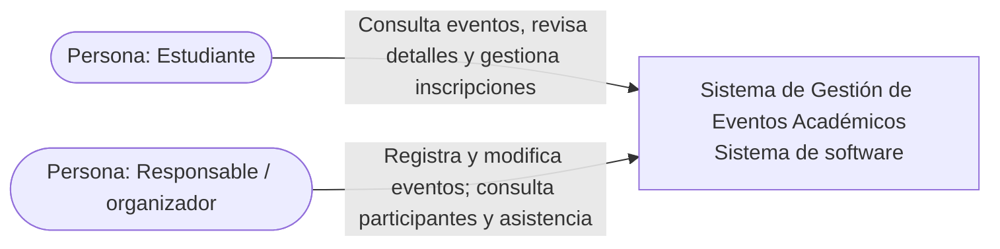
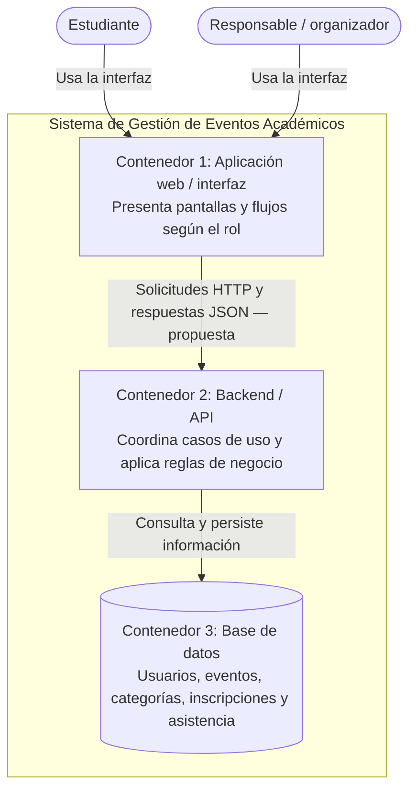
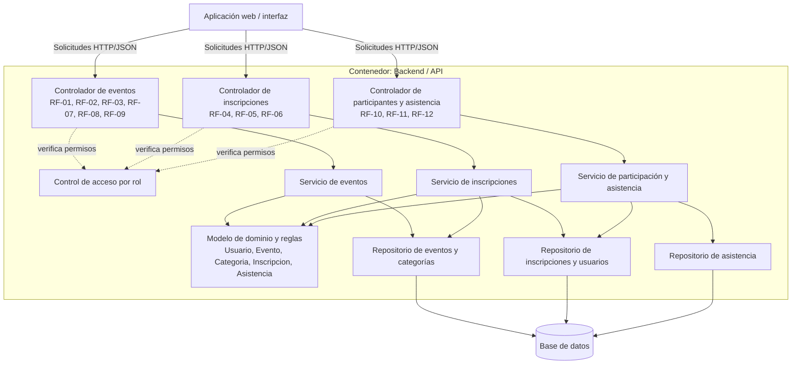
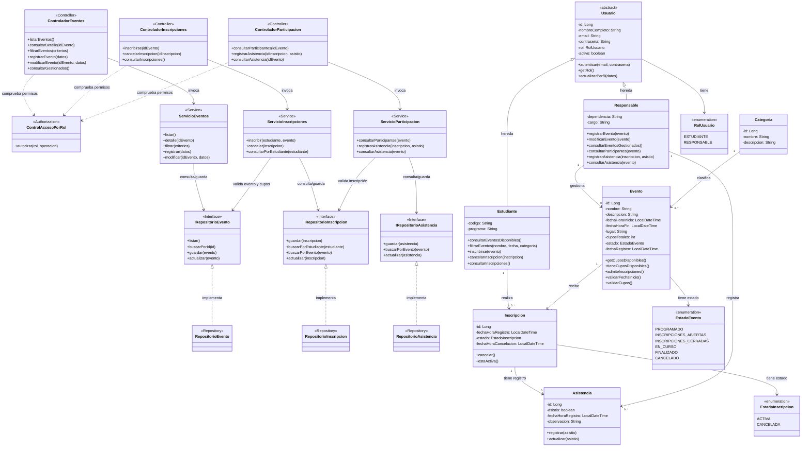

# Arquitectura C4 — Sistema de Gestión de Eventos Académicos

## Propósito

Esta propuesta representa la arquitectura del Sistema de Gestión de Eventos Académicos en cuatro niveles C4: contexto, contenedores, componentes y clases/código. Los diagramas mantienen la relación con el Modelo Verbal, los requisitos, las historias de usuario y el modelo de dominio UML ya elaborado.

## Decisiones y alcance

- **Arquitectura propuesta y tecnológicamente neutral:** en el material actual no se ha definido un lenguaje, framework ni motor de base de datos. Por eso, los nombres de interfaz web, backend/API y base de datos representan responsabilidades lógicas, no tecnologías ya elegidas.
- **Actores:** Estudiante y Responsable/organizador, coherentes con el modelo verbal y los requisitos.
- **Alcance funcional completo:** la arquitectura contempla las 12 historias de usuario: consulta y filtrado de eventos, inscripciones, gestión de eventos, participantes y asistencia.
- **MVP:** debe resaltarse el flujo principal definido en el documento: el responsable registra un evento y el estudiante consulta el listado/detalle y se inscribe. Las demás historias pueden aparecer en la arquitectura objetivo, aunque se implementen en versiones posteriores.
- **Sin sistemas externos inventados:** no se muestran correo, pagos, calendarios ni autenticación institucional externa porque no están especificados en los requisitos actuales.
- **Nivel 4:** las clases `Usuario`, `Estudiante`, `Responsable`, `Evento`, `Categoria`, `Inscripcion` y `Asistencia` provienen del UML actual. Las clases de controladores, servicios y repositorios son una propuesta para mostrar cómo organizar el código mediante capas y el patrón Repository; deben ajustarse si el equipo elige otra estructura.

> **Nota de coherencia antes de entregar:** en el Impact Map de texto aparece “Consultar eventos gestionados” bajo el actor Estudiante, pero en requisitos e HU corresponde al Responsable (RF-09 / HU-09). Conviene corregirlo. Además, el Story Map coloca el filtro por nombre en la primera versión, mientras que el resumen del MVP no lo menciona expresamente; aclaren si el filtro por nombre hará parte del MVP o de una versión posterior.

> **Decisiones tomadas en la implementación del prototipo (octubre de 2026).** Con el fin de
> cerrar las dos observaciones anteriores y dejar la documentación alineada con el código
> entregado:
>
> 1. **Impact Map corregido.** “Consultar eventos gestionados” se movió al actor
>    **Responsable** en `docs/Modelo_Verbal_del_Sistema.md`, con lo cual queda coherente con
>    RF-09 / HU-09.
> 2. **El filtrado forma parte del MVP implementado.** RF-03 / HU-03 se desarrolló
>    (**filtro por nombre, fecha y categoría**) y está disponible en la pantalla de eventos
>    del estudiante. El filtrado se ejecuta **en la API** (consulta parametrizada sobre
>    SQL Server), no ocultando elementos en el navegador. Coincide con el Story Map, que lo
>    sitúa en la versión 1, y no altera el recorrido principal: el filtro vive en un panel
>    desplegable sobre el listado y el estudiante puede consultarlo sin aplicarlo.
> 3. **Tecnología efectiva del prototipo.** La arquitectura neutra de este documento se
>    materializó en C# / .NET 10 con ASP.NET Core Web API (controladores REST), Blazor Web
>    App con interactividad de servidor y SQL Server 2022 sobre Docker Compose, con
>    JWT local para los dos roles. No se incorporaron servicios externos.
> 4. **Nivel 4 actualizado.** El diagrama de clases original se conserva como modelo de
>    dominio y, en la implementación, la enumeración `EstadoEvento` se acompaña de la
>    abstracción `IEventoEstado` con sus seis estados concretos (patrón **State**), y se
>    añaden `EventoBuilder` (patrón **Builder**) e `InscripcionFacade` (patrón **Facade**),
>    según lo definido en `docs/PATRONES.md`. Los nombres de las clases de arquitectura se
>    ajustaron al español usado en el código (`ControladorEventos`, `ServicioEventos`,
>    `RepositorioEvento`, etc.). El detalle completo está en
>    `INFORME_ARQUITECTURA_SOLID_GOF.md`.

---

# Nivel 1. Contexto

## Diagrama (fuente editable Mermaid)

## Elementos y relaciones

- **Estudiante:** consulta eventos, revisa los detalles y realiza, cancela o consulta sus inscripciones.
- **Responsable:** registra y modifica eventos, consulta los eventos que administra y hace seguimiento de participantes y asistencia.
- **Sistema de Gestión de Eventos Académicos:** centraliza la información y ofrece las funcionalidades descritas en los requisitos.
- **Sistemas externos:** no se incluyen porque el alcance actual no define integraciones con otras plataformas.

## Explicación breve

El diagrama de contexto muestra quién utiliza el sistema y qué objetivo persigue cada actor. Se conecta con el Modelo Verbal, donde se identificaron las dificultades de estudiantes y responsables por tener la información y los procesos distribuidos. La solución propuesta centraliza la consulta, inscripción y gestión de los eventos.

## Relación con el trabajo previo

- Modelo verbal: problema de información dispersa y dificultades en inscripciones y asistencia.
- Requisitos de usuario: RU-01 a RU-07.
- Historias de usuario: HU-01 a HU-12, agrupadas en cuatro épicas.

**Imagen para la entrega:** exportar el diagrama de esta sección como PNG o SVG desde el editor elegido.

**Enlace editable:** pegar aquí el enlace generado por la plataforma donde se reconstruya el diagrama. La fuente Mermaid incluida arriba también es editable.

---

# Nivel 2. Contenedores

## Diagrama (fuente editable Mermaid)

## Contenedores y responsabilidades

| Contenedor                | Responsabilidad                                                                                                                                | Requisitos relacionados                                   |
| ------------------------- | ---------------------------------------------------------------------------------------------------------------------------------------------- | --------------------------------------------------------- |
| Aplicación web / interfaz | Presentar el listado y detalle de eventos, filtros, inscripción y pantallas de gestión según el rol. Aplicar una navegación clara y adaptable. | RF-01 a RF-12; RNF-01, RNF-02, RNF-04 y RNF-05            |
| Backend / API             | Recibir solicitudes, controlar permisos, ejecutar los casos de uso y validar las reglas de negocio antes de modificar información.             | RF-01 a RF-12; RNF-03; RN-01 a RN-08                      |
| Base de datos             | Guardar de forma persistente usuarios, eventos, categorías, inscripciones y asistencias.                                                       | Entidades del diagrama de clases y requisitos funcionales |

## Explicación breve

El sistema se separa en tres responsabilidades: la interfaz con la que interactúan los usuarios, el backend que aplica la lógica funcional y las reglas de negocio, y la base de datos que conserva la información. Así, las reglas como impedir inscripciones sin cupos o registrar asistencia solo a estudiantes inscritos se validan en el backend, y no dependen únicamente de lo que muestre la interfaz.

La tecnología concreta de cada contenedor queda **por definir** hasta que el equipo establezca la plataforma de implementación. El uso de HTTP/JSON es una propuesta de comunicación entre la interfaz y el backend, no una decisión tecnológica ya confirmada.

## Relación con el MVP

El recorrido central del MVP es:

1. El responsable registra un evento desde la interfaz.
2. La solicitud llega al backend, donde se validan los datos y las reglas de negocio.
3. El backend persiste el evento en la base de datos.
4. El estudiante consulta el listado y el detalle del evento.
5. El estudiante solicita inscribirse; el backend valida cupos y duplicados antes de guardar la inscripción.

**Imagen para la entrega:** exportar el diagrama como PNG o SVG.

**Enlace editable:** pegar aquí el enlace de la plataforma elegida. Conservar también la fuente Mermaid para poder modificarlo.

---

# Nivel 3. Componentes

Este nivel descompone el contenedor **Backend / API**. La interfaz web y la base de datos se muestran fuera de ese contenedor para explicar sus dependencias.

## Diagrama (fuente editable Mermaid)

## Componentes y responsabilidades

| Componente                                | Responsabilidad                                                                                                                        | Trazabilidad principal                                                             |
| ----------------------------------------- | -------------------------------------------------------------------------------------------------------------------------------------- | ---------------------------------------------------------------------------------- |
| Controlador de eventos                    | Recibir solicitudes para listar, consultar, filtrar, registrar, modificar y consultar eventos gestionados.                             | RF-01, RF-02, RF-03, RF-07, RF-08, RF-09; HU-01, HU-02, HU-03, HU-07, HU-08, HU-09 |
| Controlador de inscripciones              | Recibir solicitudes para inscribirse, cancelar y consultar inscripciones.                                                              | RF-04, RF-05, RF-06; HU-04, HU-05, HU-06                                           |
| Controlador de participantes y asistencia | Recibir solicitudes para consultar participantes y registrar o consultar asistencia.                                                   | RF-10, RF-11, RF-12; HU-10, HU-11, HU-12                                           |
| Control de acceso por rol                 | Verificar que las operaciones correspondan al rol autorizado.                                                                          | RNF-03; `Usuario` y `RolUsuario` del UML                                           |
| Servicios de aplicación                   | Coordinar los casos de uso y aplicar las validaciones necesarias antes de guardar cambios.                                             | Historias de usuario y criterios de aceptación Gherkin                             |
| Modelo de dominio y reglas                | Representar las entidades y validar condiciones, como cupos, fechas, duplicados, estado de inscripción y elegibilidad para asistencia. | `Evento`, `Inscripcion`, `Asistencia` y RN-01 a RN-08                              |
| Repositorios                              | Separar la lógica funcional del mecanismo usado para consultar y guardar los datos.                                                    | Entidades del UML y contenedor de base de datos                                    |

## Reglas de negocio ubicadas en componentes

- **Servicio de eventos:** validar fecha de inicio y cupos al crear o modificar un evento (RN-03 y RN-04); mantener los datos consistentes.
- **Servicio de inscripciones:** rechazar inscripciones sin cupos, duplicadas o fuera del período permitido; impedir superar la capacidad del evento (RN-01, RN-02, RN-05, RN-07 y RN-08).
- **Servicio de participación y asistencia:** comprobar que el estudiante tenga una inscripción antes de registrar asistencia (RN-06).

## Explicación breve

El nivel de componentes muestra cómo se reparte el trabajo dentro del backend. Los controladores reciben las solicitudes, los servicios coordinan las operaciones, el modelo de dominio representa los conceptos del negocio y los repositorios encapsulan el acceso a los datos. El control por rol ayuda a cumplir el requisito de seguridad.

Esta separación facilita comprobar los criterios Gherkin y evita que las reglas de negocio dependan solamente de la interfaz. Los componentes son una **propuesta de diseño**: sus nombres pueden adaptarse al lenguaje y framework que el equipo seleccione.

**Imagen para la entrega:** exportar el diagrama como PNG o SVG.

**Enlace editable:** pegar aquí el enlace de la plataforma elegida. Conservar la fuente Mermaid incluida en esta sección.

---

# Nivel 4. Código / Clases: dominio y patrones

El diagrama existente de clases del proyecto debe mantenerse como base del **modelo de dominio**. Para conectar ese modelo con el nivel 3, se añaden clases propuestas de controladores, servicios y repositorios. De esta manera se muestra no solo qué entidades existen, sino cómo se organiza el código alrededor de ellas.

## Diagrama de clases (fuente editable Mermaid)

## Patrones y organización propuesta

- **Arquitectura por capas:** separa presentación/controladores, servicios de aplicación, dominio y persistencia. Cada parte tiene una responsabilidad delimitada.
- **Patrón Repository:** los servicios trabajan con interfaces de repositorio (`IRepositorioEvento`, `IRepositorioInscripcion`, `IRepositorioAsistencia`) en lugar de depender directamente del motor de base de datos.
- **Controlador–Servicio–Repositorio:** los controladores reciben solicitudes, los servicios ejecutan los casos de uso y aplican reglas; los repositorios gestionan la persistencia.
- **Herencia:** `Estudiante` y `Responsable` heredan atributos y operaciones comunes de la clase abstracta `Usuario`.
- **Enumeraciones:** `RolUsuario`, `EstadoEvento` y `EstadoInscripcion` restringen los estados y roles posibles.

## Explicación breve

El nivel 4 conecta las funcionalidades con las clases que las soportan. Por ejemplo, la inscripción utiliza `Estudiante`, `Evento` e `Inscripcion`; la asistencia utiliza `Inscripcion` y `Asistencia`. Los servicios aplican las reglas antes de solicitar a los repositorios que consulten o guarden la información. La clase abstracta `Usuario` reúne los datos comunes de estudiante y responsable, mientras que las enumeraciones controlan los valores válidos.

**Importante:** el diagrama incorpora clases de arquitectura (`Controlador...`, `Servicio...` y `Repositorio...`) que no aparecen en el UML de dominio original. Son una propuesta para completar la vista de código y mostrar los patrones. No deben presentarse como clases ya implementadas si aún no existen en el código del proyecto.

**Imagen para la entrega:** exportar el diagrama de clases como PNG o SVG. Si el resultado queda demasiado ancho, se puede presentar en dos vistas relacionadas: (1) clases de arquitectura y patrones; (2) clases del dominio y relaciones.

**Enlace editable:** pegar aquí el enlace de la plataforma donde se edite el diagrama. Conservar la fuente Mermaid para las modificaciones.

---

# Matriz de trazabilidad resumida

| Elemento de arquitectura                           | Requisitos / historias relacionadas                                                        | Reglas y RNF relacionadas                     |
| -------------------------------------------------- | ------------------------------------------------------------------------------------------ | --------------------------------------------- |
| Aplicación web                                     | HU-01 a HU-12; representa los flujos de los dos roles                                      | RNF-01, RNF-02, RNF-04, RNF-05                |
| Controlador y servicio de eventos                  | HU-01, HU-02, HU-03, HU-07, HU-08, HU-09                                                   | RN-03, RN-04                                  |
| Controlador y servicio de inscripciones            | HU-04, HU-05, HU-06                                                                        | RN-01, RN-02, RN-05, RN-07, RN-08             |
| Controlador y servicio de participación/asistencia | HU-10, HU-11, HU-12                                                                        | RN-06                                         |
| Control de acceso por rol                          | Operaciones diferenciadas de estudiante y responsable                                      | RNF-03                                        |
| Modelo de dominio                                  | `Usuario`, `Estudiante`, `Responsable`, `Evento`, `Categoria`, `Inscripcion`, `Asistencia` | RN-01 a RN-08                                 |
| Repositorios y base de datos                       | Persistencia de eventos, usuarios, categorías, inscripciones y asistencia                  | Consistencia de los datos y reglas de negocio |

# Preparación de la entrega

Para cada nivel, incluir en el documento final:

1. **Imagen:** exportada del diagrama como PNG o SVG.
2. **Enlace editable:** URL de la fuente en la plataforma elegida, con permisos para que el docente pueda abrirla.
3. **Explicación breve:** utilizar el texto de la sección correspondiente.

Como opción de trabajo, el código Mermaid se puede pegar en un editor compatible con Mermaid y después exportarse como imagen. Para el enlace editable, se debe guardar o compartir el diagrama desde la plataforma elegida; no basta con enlazar a la página principal del editor.
